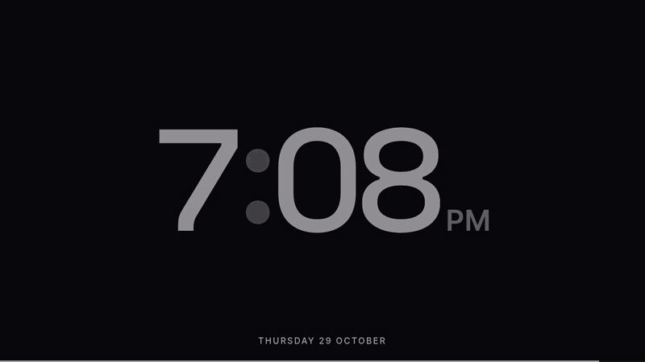

<p align="center">
  
</p>

# minimal-live-clock

A small, full-screen clock I built for fun. One HTML page, one script, no build step, no dependencies.

[Watch the demo as MP4](assets/demo.mp4) · [Roadmap](ROADMAP.md)

## Features

- Big, clean time that scales to any screen
- Optional seconds
- Progress ring: minutes left this hour, part of the day, or the whole day
- Month progress bar along the bottom edge
- BRB screen with a message you can edit by clicking it
- Fullscreen, with the cursor hiding itself when idle
- Controls stay hidden until you move the pointer to the bottom edge (tap on touch screens)
- Remembers your settings

## Shortcuts

| Key | Action |
| --- | --- |
| `S` | Toggle seconds |
| `R` | Cycle the ring: off, hour, part of day, day |
| `B` | Toggle the BRB screen |
| `F` | Toggle fullscreen (or double-click anywhere) |

## Install

### Use it as your Chrome new tab page

This works in Chrome and other Chromium browsers (Edge, Brave, Arc).

1. Download or clone this repo:
   ```sh
   git clone <this-repo-url>
   ```
2. Open `chrome://extensions` in Chrome.
3. Turn on **Developer mode** (top right).
4. Click **Load unpacked** and select the repo folder (the one containing `manifest.json`).
5. Open a new tab. The clock replaces the new tab page.

To get the normal new tab page back, turn the extension off or remove it on `chrome://extensions`.

Good to know:

- Chrome focuses the address bar on a new tab, so click the page once before using the keyboard shortcuts.
- Fonts load from Google Fonts, so the first load needs a connection. Offline, it falls back to a system font.
- Chrome 138+ adds a footer to new tab pages provided by extensions (the extension name and a "Customize Chrome" button). It isn't part of the clock and an extension can't remove it. To hide it, use the "Show footer on New tab page" toggle in Customize Chrome, or right-click the footer and hide it.
- Chrome may show a "disable developer mode extensions" notice on startup. Dismiss it, or keep the extension loaded as is.

### Or just open the file

Open `index.html` in any modern browser. No server needed.

## Files

- `index.html`: markup and styles
- `script.js`: clock logic
- `manifest.json`: makes it a Chrome new tab extension
- `assets/`: demo video used above
